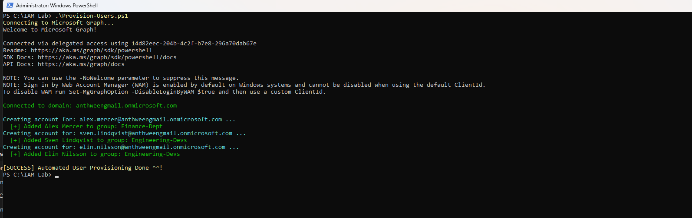
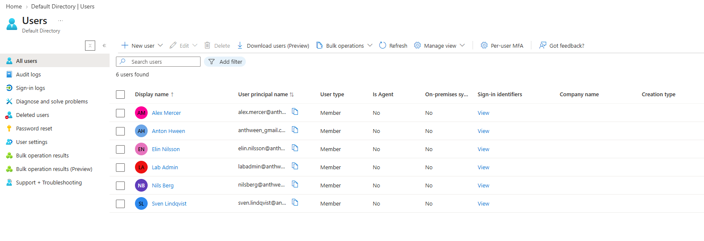
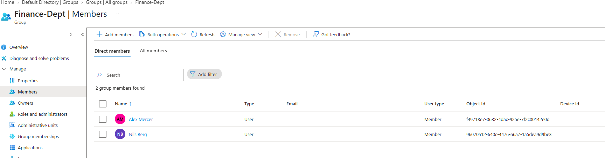
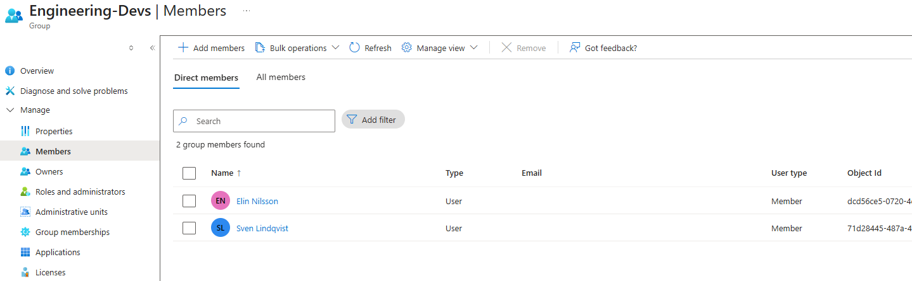
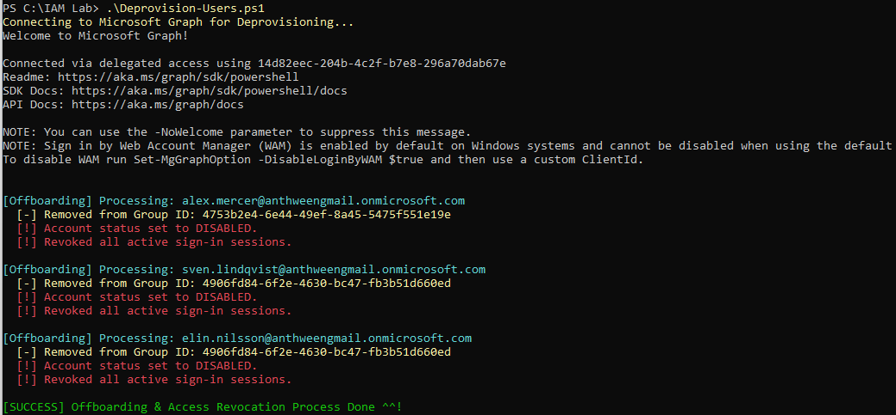

# Automated User Onboarding Offboarding in Entra ID

# Entra ID IAM Lifecycle Lab

This is a practical lab I built to show automated identity and access management (IAM) using PowerShell and the Microsoft Graph API.

## Tools and Platform
- **Cloud Platform:** Microsoft Entra ID (formerly Azure AD)
- **SDK & API:** Microsoft Graph PowerShell SDK (`Users`, `Groups`, `Identity.DirectoryManagement`, and `Users.Actions`)
- **Shell:** PowerShell
- **Data Input:** CSV (`new_hires.csv`)

## What I Built and Tested
- **Automated User Onboarding (`Provision-Users.ps1`):** Wrote a PowerShell script that parses CSV data, auto-detects the tenant's primary domain name, provisions user accounts, sets temporary passwords with forced resets on first login, and assigns users to target security groups.
- **Automated Offboarding (`Deprovision-Users.ps1`):** Wrote an offboarding script that strips group access, sets `AccountEnabled = $false`, and revokes active OAuth sign-in sessions across all devices using `Revoke-MgUserSignInSession`.
- **Error Handling & Efficiency:** Configured splatting hashtables (`@userParams`) to keep parameters clean.
- **Soft Offboarding Strategy:** Kept account soft-deprovisioning over hard deletion to preserve audit trails, mailbox data, and compliance records.

## Project Screenshots
1. User provisioning Script Execution
 
2. Entra ID Users & Group Assignment

4. Deprovisioning & Session Revocation
5. 
